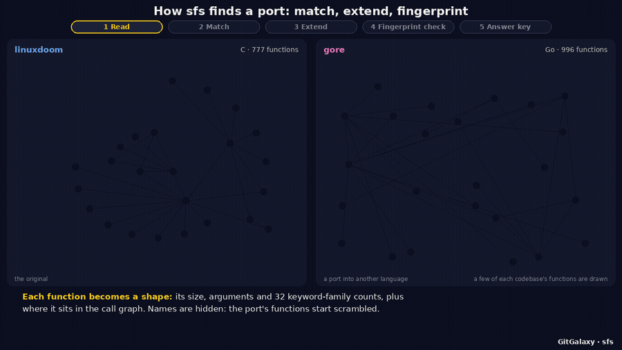

# DOOM's DNA (`doom-dna`)

A standalone, reproducible study of **44 DOOM ports** across ~20 programming languages, measured by structural geometry and call-graph wiring without reading identifiers or comments.

> **Separation of concerns:** [gitgalaxy](https://github.com/squid-protocol/gitgalaxy) (`tests/doom_rosetta/`) owns the engine CI regression gate. This repository owns the **scientific study**: manifests, keyword-interpretation standards, preregistered follow-up experiments, measurement scripts, results, and the interactive article.

## The Method, Shown: Match, Extend, Fingerprint

How a port is found without reading a single name: linuxdoom (C, 777 functions) against gore, its Go port (996
functions), run through [structural-fingerprint-scanner](https://github.com/squid-protocol/structural-fingerprint-scanner)
(`sfs lattice-compare`). [MP4](docs/media/seed-extend.mp4)

1. **Read.** Each function becomes a shape: its size, arguments and 32 keyword-family counts, at a place in its call
   graph. Names are hidden.
2. **Match.** Optimal transport (FGW) pairs functions whose shape *and* call-graph position agree. The strongest 15%
   of the pairs that pick each other become anchors (66).
3. **Extend.** The C → Go offset is measured on the anchors. Then, for 3 hops, a caller or callee of a matched function
   pairs with its partner's closest unclaimed neighbour (598 matched).
4. **Fingerprint check.** Matching finds partners even in unrelated code, so each pair's keyword fingerprint and shape
   must beat decoys (shuffled look-alike functions) to count as sufficient evidence:

   | | pairs with sufficient evidence |
   |---|---:|
   | gore (Go port) | 121 of 598 |
   | rust-doom (Rust rewrite) | 0 of 123 |
   | random one-to-one pairing (same function) | 0 of 777 |

5. **Answer key.** Names, never used, grade it: 108 of the 121 are the same function. The film ends on all 777
   linuxdoom functions coloured by verdict.

**These numbers are the `sfs` library's, not this study's tables.** The film runs `sfs` at engine `9f213ab83` with its
decoy-calibrated evidence check. This study's own sweep (`followups/seed-and-extend/measure.py`) differs in three ways:
- it uses engine `6c7c6c1bc` scans;
- it drops complexity features;
- it applies its own quality gate.

Its gore result is therefore 430 of 561, not 364 of 598. Method details, caveats and how the film is rendered:
[sfs `docs/media/README.md`](https://github.com/squid-protocol/structural-fingerprint-scanner/blob/main/docs/media/README.md).

## Repository Layout

| Directory | Purpose |
|---|---|
| `manifest/` | Pinned 44-port corpus (`manifest.csv`, `scope.csv`), `declared_lineage.csv`, `subsystems.json`, `timeline_events.csv` |
| `docs/` | Canonical measurement contracts, starting with [docs/KEYWORD_MODES.md](docs/KEYWORD_MODES.md); the method film in `docs/media/` |
| `preregistration/` | Registered hypotheses for open questions (`DOOM-E1`..`DOOM-E4`) |
| `measure/` | Study-side measurement, lineage, fidelity, and report-generation scripts |
| `results/` | Generated evidence artifacts (`blind_placement.*`) and [RESULTS.md](RESULTS.md) |
| `followups/` | Exploratory & registered follow-up experiments (`oop-function-collapse/`, `composition-lens/`) |
| `article/` | Interactive HTML article (`index.html`, `data.json`, media) and text edition (`teardown-of-doom.md`) |
| `tests/` | Structural integrity & schema checks (`pytest`) |

## Headline Conclusions

1. **Name-blind twins work within a language:** `sfs twins` achieves **93% precision** (65% recall) against source-text function diffs (Spearman ρ = 0.83–0.84 across 43–44 programs), while unrelated C controls (Quake, Quake II, Lua) sit at 0–0.6%.
2. **Unsupervised Seed-and-Extend recovers 1-to-1 DOOM DNA across translations:** Using `composition` mode, FGW reciprocal-best-hit seeding, `delta` translation-offset calibration, and 3-hop call-graph extension (zero names or paths read), we recover **95.3%** (`687/721`) of `mood` (C+COBOL), **89.0%** (`590/663`) of `puredoom` (single-header C), **84.9%** (`547/644`) of `doomgeneric`, **75.9%** (`426/561`) of `gore` (**Go**, even with flat directory layout), and **65.0%** (`433/666`) of `chocolate-doom`, while unrelated C controls (`lua` 0.0%, `quake` 0.6%, `quake2` 0.6%) and from-scratch reimplementations (`room4doom`, `rust-doom`, `helion` all **0.0%**) sit at noise ([FINDING.md](followups/seed-and-extend/FINDING.md)).
3. **Cross-pair permutations & expanded language/architecture controls confirm zero false DNA:** Across **66** pairwise permutations of novel/from-scratch/COBOL repos (`agentic-cobol-doom-cc`, `agentic-cobol-doom-codex`, `fps-cob`, `fsharp-doom`, `doomf77`, `cssdoom`, `sqldoom`, `rust-doom`) and **6** new permissive controls (`carddemo-cobol-ctrl`, `c-raycasting`, `c-raycasting2`, `goom3d`, `bubbletea`, `macroquad`), every non-DOOM pair scores **0–1** SE name hits. Meanwhile, the three COBOL raycasters cluster in FGW cost (**`0.670–0.706`** vs. **`0.748–0.775`** against same-size business COBOL `carddemo-cobol-ctrl`) and align analogous raycaster roles without names ([CONTROLS_CROSSPAIRS.md](followups/seed-and-extend/CONTROLS_CROSSPAIRS.md)).
4. **Preregistered held-out test (`DOOM-E5`):** On 5 held-out repos preregistered prior to cloning ([EXPERIMENTS.md](preregistration/EXPERIMENTS.md), [DOOM_E5_RESULTS.md](followups/seed-and-extend/DOOM_E5_RESULTS.md)), Seed-and-Extend confirmed `cydoomgeneric` (`100.0%` Tier-1 to `doomgeneric`, `FGW_cost=0.313`), `DOOM-style-Game` (`0.0%`), and `doome` (`0.0%`), while falsifications on `iron-doom` (`0.0%` — rewritten into **Bevy ECS**) and `doomarkable` (`0.0%` — 41-function Rust wrapper around external `doomgeneric-rs`) revealed that **ECS architectural rewrites erase call-graph DNA** even when ported from Chocolate Doom.
4. **Horizontal borrowing is visible without names — and Seed-and-Extend isolates the exact borrowed graph:** `eternity` (SMMU/MBF branch) and `odamex` (ZDoom branch) score only 6–12 Tier-1 hits against `linuxdoom`, yet blind Seed-and-Extend recovers **210/276** (`76.1%`, `eternity ↔ chocolate-doom`), **220/271** (`81.2%`, `eternity ↔ doom-wasm`), **178/212** (`84.0%`, `odamex ↔ chocolate-doom`), and **190/228** (`83.3%`, `eternity ↔ odamex`) Tier-1 matches directly inside Chocolate Doom's horizontally borrowed `textscreen` (`TXT_*`) UI library ([HORIZONTAL_BORROWING.md](followups/seed-and-extend/HORIZONTAL_BORROWING.md)).
5. **Architecture survives some translations above chance:** `doom-scheme` (+0.51) and `gore` (+0.50) preserve `linuxdoom`'s cross-subsystem call wiring on par with `chocolate-doom` (+0.51), and blind placement hits 60% (`κ = 0.50`) on Go vs. 20% chance.
6. **Raw wiring and graph-shape distance mislead without nulls:** Raw wiring flatters every port (`0.72–0.95`), and raw graph-shape distance does not separate DOOM ports (`0.30–3.25`) from unrelated controls (`1.04–2.30`).

## Open Questions

See [preregistration/EXPERIMENTS.md](preregistration/EXPERIMENTS.md) for the registered experiments addressing tiny OOP function splitting (`mochadoom`, `kocoa-doom`, `managed-doom`), cross-language composition matching, and subsystem `other %` coverage gates.

## Licensing & Attribution

Measurements only: no third-party source code or WAD/game data is committed. Every port in `manifest/manifest.csv` carries an explicit OSI or CC0 license. "DOOM" is used descriptively; this project is not affiliated with or endorsed by id Software, ZeniMax Media, or Microsoft.
